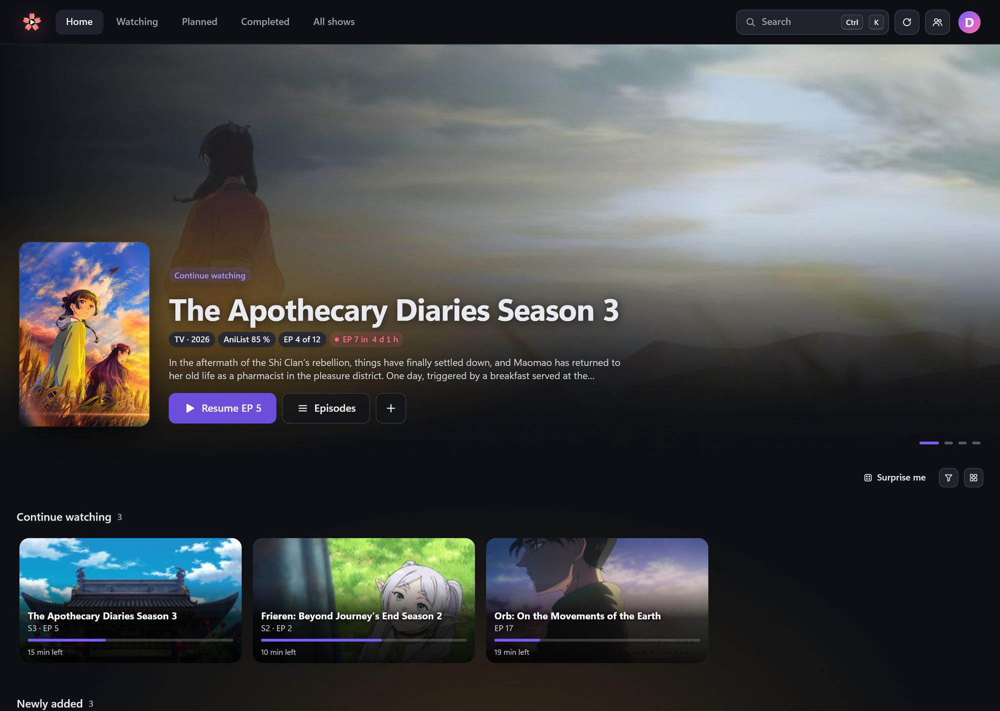
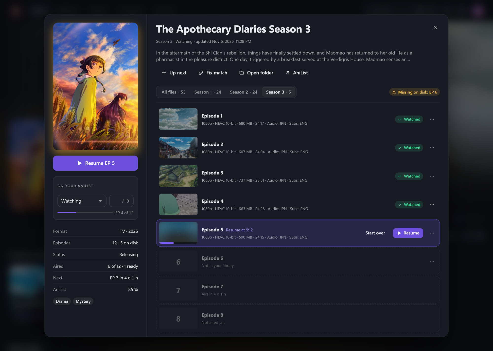
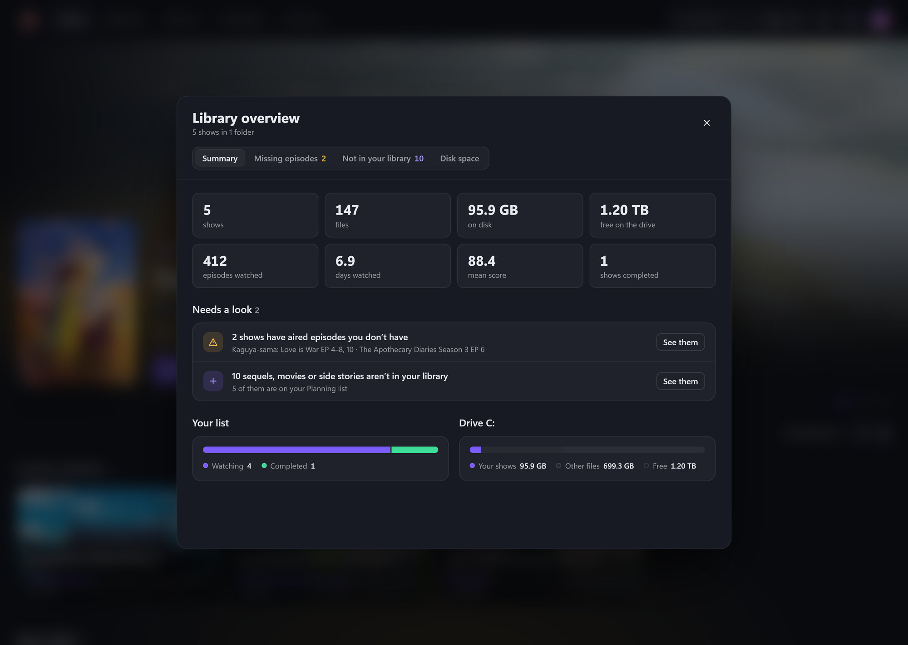
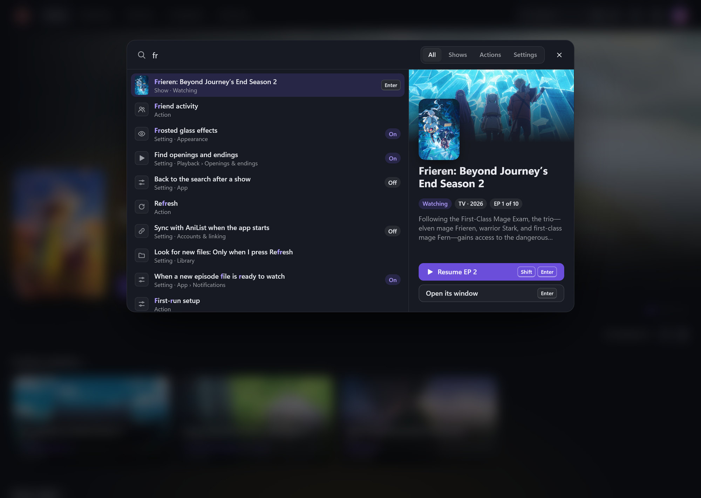
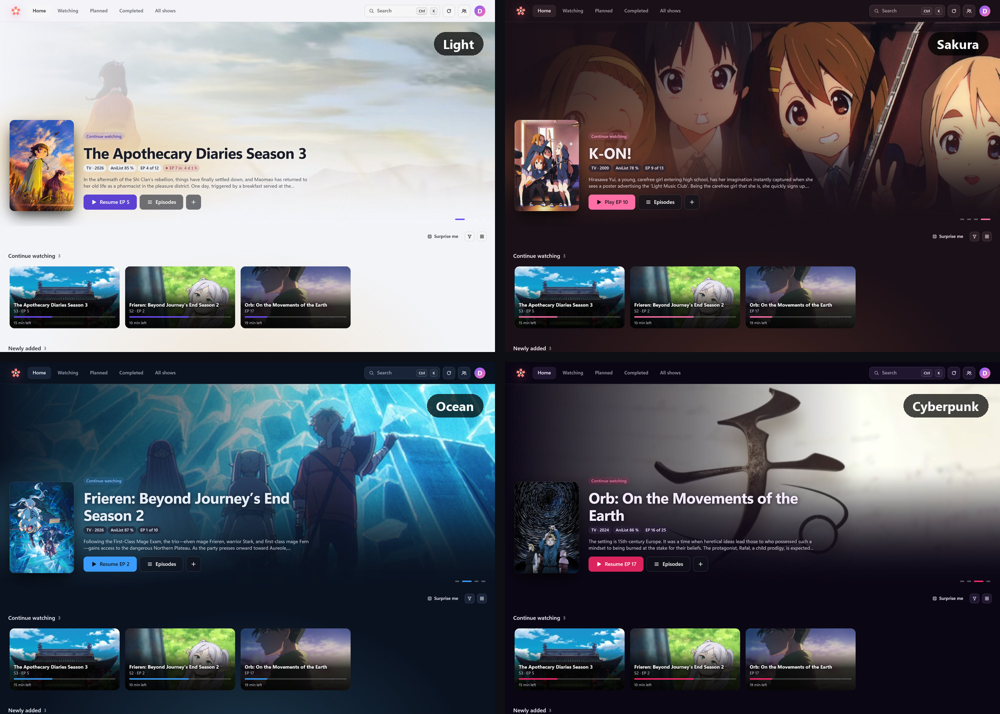

# Anirari

Your anime folders as a library: covers, seasons and episode lists from AniList, what's next to watch, playback in mpv, and your AniList
list kept up to date as you watch. It runs on your own PC, in its own window.

**[Download the latest version](../../releases/latest)** · Windows 10 and 11 · free

This repository holds the releases; what changed in each version is in its [release notes](../../releases).

## What it does

- **Your library, matched on AniList.** Anirari finds the shows in your folders and matches them on AniList: covers, banners, seasons,
  split cours, movies, specials and airing times. A wrong match is one search away (**Fix match**), and a show Anirari cannot place
  offers its best guess with **Link**.
- **What to watch next.** Continue watching (with how far you got), Up next (your own shortlist), new-episode and airing badges, a banner
  with the shows you are watching, grid or list view, filters and sorting, and a library overview (missing episodes, what is not in your
  library yet - next seasons, movies, OVAs, your Planned list - and disk space per show).
- **Search everything with Ctrl+K**: shows, actions and settings, from anywhere.
- **Episode windows**: every episode with a thumbnail and its file details (resolution, audio and subtitle languages), the next one to
  watch highlighted, your AniList status, score and progress, the seasons as tabs, other versions of an episode grouped under it, and
  the episodes you don't have yet listed with when they air.
- **Plays in mpv**, resumes where you stopped, plays the next episode by itself if you like, skips openings and endings (it finds them by
  listening to the episodes), and marks the episode watched on AniList when you reach the credits.
- **On your phone** (new in 2.0, optional): your library in the phone's browser, and each episode opens in **VLC on the phone**,
  played straight from your PC - at home, or anywhere through Tailscale.
- **Your AniList list in step**: progress, status and score. Changes made while you are offline are kept and sent once AniList can be
  reached, and every change can be undone.
- **Make it yours**: 10 themes, a theme builder (poster colours, ambient glow, background gradients), your own CSS (saved as profiles),
  which lists the header shows and in what order, card sizes, Reduce motion, optional sound effects.
- Optional: **Discord** status, **Windows notifications** for new episodes, your **friends' activity** from AniList.
- **Backups** of everything that matters (settings, match fixes, resume points, watch history, Up next) - automatic, every week unless you
  choose otherwise - and a diagnostics page for when something is off.

## A look around

**A show's window**: every episode with its thumbnail and file details, your AniList status, score and progress, the seasons as
tabs, and when the next one airs.

**Library overview**: totals, what needs a look (aired episodes missing on disk, sequels and movies not in your library yet), your
list by status and your drives.

**Ctrl+K**: one search for shows, actions and settings, with a preview of the highlighted one.

**Themes**: ten built in (here Light, Sakura, Ocean and Cyberpunk) and a theme builder for your own.

*The screenshots show a demo library.*

## What you need

- **Windows 10 or 11.**
- **Microsoft Edge or Google Chrome** for the app's window (Edge comes with Windows). Without either, Anirari opens in your default browser.
- Recommended: **[mpv](https://mpv.io/installation/)** or **[mpv.net](https://github.com/mpvnet-player/mpv.net)** to play episodes. That is
  what lets Anirari follow how far you got, resume and mark episodes watched; without it, episodes open in your default video app.
- An **[AniList](https://anilist.co)** account to keep your list in step. Without one the library still works: covers and matching come
  from AniList's public data.
- ffmpeg comes with Anirari (thumbnails, file details, finding openings and endings).

## Install

- **Anirari-&lt;version&gt;-Setup.exe** (easiest) installs Anirari for you only - no administrator needed - into
  `%LOCALAPPDATA%\Programs\Anirari`, with a Start menu entry (a desktop shortcut and Start with Windows if you tick them) and an entry in
  **Settings › Apps** to uninstall it. Installing a new version over the old one keeps everything.
- **Anirari-&lt;version&gt;-portable.zip** is the same without installing: unzip it anywhere and run `Anirari.exe`.

Anirari is not code-signed, so Windows may warn about an unknown publisher the first time: **More info › Run anyway**.

On the first start, a short setup walks you through adding your anime folders, logging in with AniList and a few preferences, then scans
your library. Starting Anirari while it is already running brings its window to the front.

## Connecting AniList

Press **Log in with AniList** in the setup (or **Settings › Accounts & linking**), approve on AniList's page, and you come back logged in.
There is nothing to set up, as long as Anirari runs on its usual port, 8765.

On another port, or if you prefer, use an AniList API client of your own: create one at
[anilist.co/settings/developer](https://anilist.co/settings/developer) with the Redirect URL Anirari shows you
(`http://localhost:8765/callback` by default), paste its Client ID in **Settings › Accounts & linking** and press **Connect**.

Your login is stored encrypted for your Windows account.

## On your phone

**Settings › App › Phone access** (off until you turn it on):

1. Turn on **Let a phone open Anirari**. Settings shows the address to open on the phone (your PC on the home network, and its
   Tailscale name if you have Tailscale).
2. Open that address in the phone's browser, press **Pair a phone** on the PC, and type the 6-digit code on the phone.
3. The phone gets your library. Tap an episode (or **Play next**): it opens in **VLC** on the phone, which plays it straight from the
   PC - seeking works, and the PC stays awake while VLC reads. **Copy link** gives the link for another player.

Back from VLC, the phone asks **Finished EP 5?** - marking is always your tap. Marking, status, score and Up next work from the phone;
settings and folders stay on the PC. On an iPhone, VLC needs **Local Network** allowed (Settings › Privacy & Security › Local
Network).

- **Away from home**: install [Tailscale](https://tailscale.com/) on the PC and the phone (the same account) and pair with the PC's
  Tailscale name: it works at home and away. **Secure address through Tailscale** serves Anirari over https.
- **Windows Firewall** may keep phones out: **Allow phones in Windows Firewall** adds Anirari's own two rules for the phone port, with
  Windows' permission - your home network on private networks only, and Tailscale.
- Paired phones are listed with **Remove**, which ends a phone's links at once.

## Everyday use

| | |
|---|---|
| **Ctrl+K** or **/** | Search shows, actions and settings |
| **?** | Every keyboard shortcut |
| **Arrow keys** | Move between cards and rows once one has focus (Tab, or a click), up to the banner, and between episodes in a show's window |
| **Refresh** | Look for new files and sync with AniList. Anirari never syncs by itself, unless you turn on **Sync with AniList when the app starts** |
| An episode's **⋯** menu: **Mark** / **Mark up to here** / **Unmark** | Change your AniList progress by hand (undo in the message that follows) |
| **Fix match** | When a show is matched to the wrong AniList entry |
| The filter button | Genre, year, sorting, and on All shows which lists to show |
| **Private mode** | Nothing is marked on AniList automatically, no Discord status, no watch history - until you turn it off |

While an opening or ending plays in mpv, press **Enter** to skip it - or let Anirari skip them by itself (**Settings › Playback**).

## Your data and privacy

Everything Anirari keeps is on your PC, in `%APPDATA%\Anirari` (**Settings › Data & storage › Data folder › Open**): settings, match fixes,
resume points, watch history, your encrypted AniList login, the library cache, thumbnails and covers, the log and backups.

What leaves your PC:

- **AniList**: searches to match your shows; your list, when you press Refresh (or at start, if you turned that on), and then the sequels and
  movies of your shows (at most once a week); the changes you make or
  Anirari makes for you (marks, status, score); friend activity, when you open it; covers and banners from AniList's image servers.
- **Discord**, only if you set it up: what you're watching, through the Discord app on your PC.
- **Tailscale**, only with Phone access on and Tailscale installed: Anirari asks the Tailscale program on your PC for its address and
  name (and, with the secure address on, has it serve Anirari over https).
- **GitHub** (this page), once a day and when you press **Check for updates**: which version is the newest - and on an installed copy
  the new version's setup, when there is one. Both can be turned off in **Settings › About**.
- Nothing else: no analytics, no telemetry.

Anirari's server listens only on your own PC (`127.0.0.1`), so websites you visit cannot use it. With **Phone access** on, a second
listener answers on your home network and Tailscale addresses only (port 8766): to paired phones, and to anyone else only with the
pairing page. Backups and support bundles never contain
your AniList login, and a backup or settings file from someone else cannot change which programs Anirari runs unless you tick them.

## Updating

From 1.4.1 on, the copy the setup installed **updates itself**: Anirari looks here once a day (and when you press **Settings › About ›
Check for updates**), downloads a newer version in the background - kept only if it is exactly the file published here, same size and
SHA-256 - and asks. **Install and restart** makes a backup, closes Anirari, updates it and opens it again in the same window: everything
you had stays. **Later** asks again the next time you open it. Both parts can be turned off in Settings › About.

The portable zip, and 1.4.0 or older: Settings › About shows what is new with a button to the download - run the new setup over the old
one, and everything you had stays.

## When something is wrong

| Problem | Try |
|---|---|
| AniList says the login expired | **Settings › Accounts & linking › Connect** again; **Diagnostics & logs › Check with AniList** tests it. Two weeks before it runs out, a line above the library offers **Reconnect** |
| "AniList did not accept your login just now" | Your login is kept and tried again on **Refresh** (and by itself after 10 minutes). If it keeps happening, connect again |
| Refresh says AniList could not be reached | Your saved list stays and your shows keep their matches; press **Refresh** again once you're online |
| A line says a library folder can't be reached | Switch the drive on or reconnect the network folder (or fix the folder in **Settings › Library**), then **Look again**. Nothing is lost while it's away |
| Anirari says your settings could not be read | The damaged file is kept as `config.broken-<date>.json` in the data folder. Review the newest automatic backup when it asks - or later in **Settings › Data & storage › Backup & restore** |
| A show is matched wrongly | **Fix match** in its window |
| VLC on an iPhone says Playback failed | Allow VLC **Local Network** (Settings › Privacy & Security › Local Network), and check that the phone is on the same network or on Tailscale |
| The phone can't open Anirari's address | **Allow phones in Windows Firewall** in **Settings › App › Phone access**; at home, check the phone is on the same Wi-Fi |
| No thumbnails or file details | **Settings › Data & storage › Diagnostics & logs** shows which ffmpeg is used; **ffmpeg program** sets another |
| Episodes open in the wrong player | **Settings › Playback › Play with** and **Player program** |
| Your own CSS hid something | **Ctrl+Alt+C** turns custom CSS off |
| "Another program is using port 8765" (Anki's AnkiConnect add-on uses it too) | Let Anirari use a free port when it asks, or pick one in **Settings › Data & storage › Port** |
| Anything else | **Settings › Data & storage › Diagnostics & logs**: the log, system details and **Download support bundle** (without your login) |

## Uninstalling

**Settings › Apps › Anirari › Uninstall** removes what the setup installed, its shortcuts and its Apps entry - and your settings and library
data in `%APPDATA%\Anirari` only if you choose to. The portable version: quit Anirari and delete its folder (and `%APPDATA%\Anirari` if you
won't come back).

## License notes

ffmpeg and ffprobe come with Anirari: FFmpeg 9.0.2, a build from [gyan.dev](https://www.gyan.dev/ffmpeg/builds/), licensed under the GNU
GPL v3 (`ffmpeg-LICENSE.txt` next to them). Its source code: <https://ffmpeg.org/releases/ffmpeg-9.0.2.tar.xz>.
